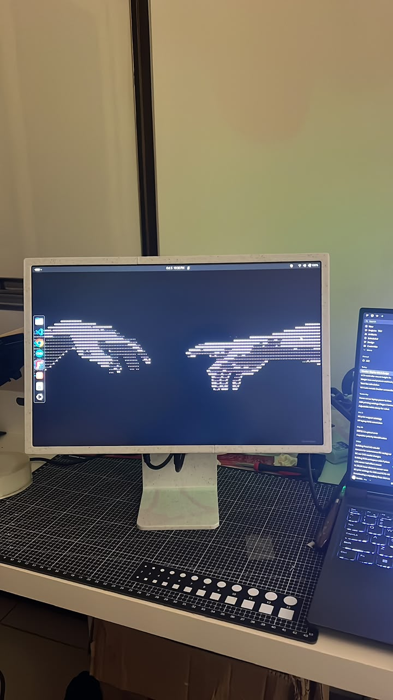
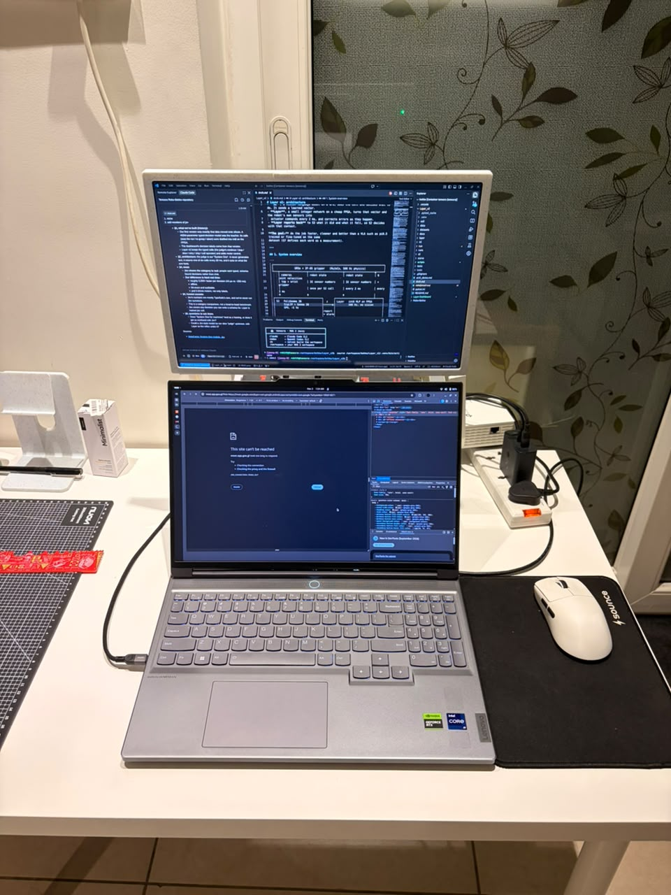
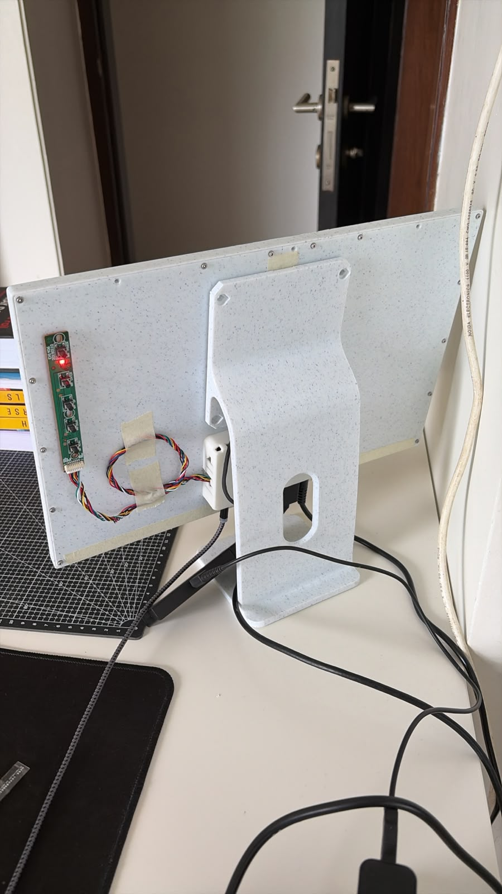
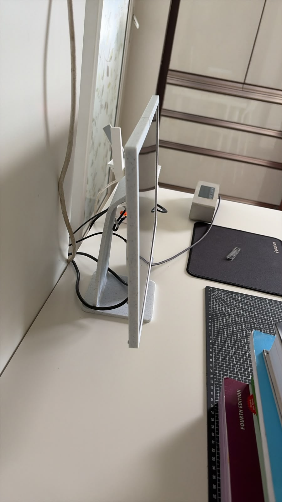
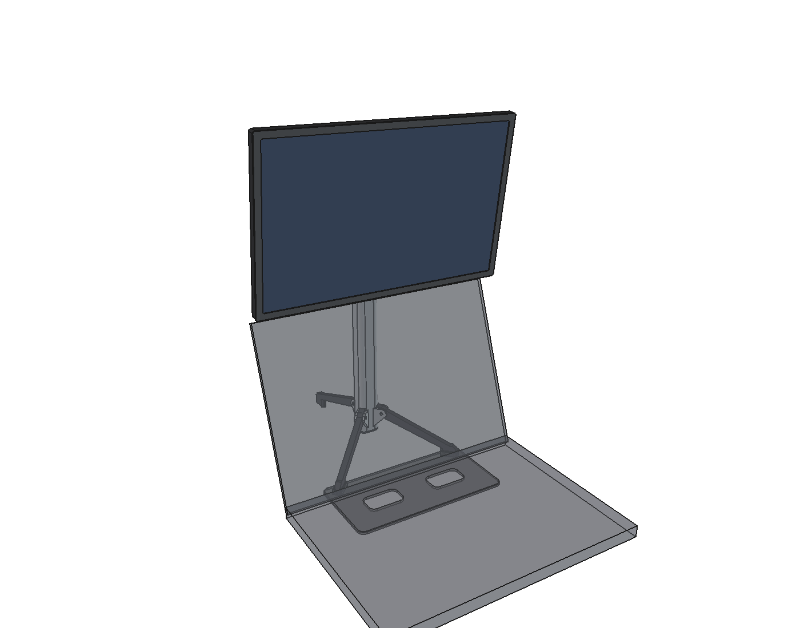
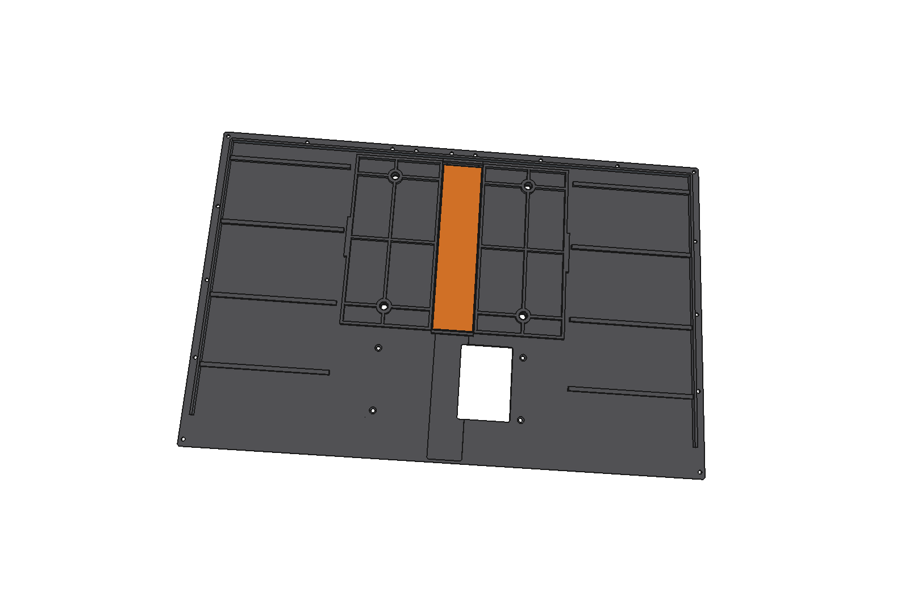

# Display Case

A 3D-printed enclosure that turns a salvaged 16-inch laptop panel into a standalone monitor, plus
two stands to hold it. The repo has the print files, FreeCAD models, build scripts and design
notes for every revision.

## Finished v2

| Running, on the desk stand | Above the laptop | Rear, with the keypad board taped on | Side |
|---|---|---|---|
|  |  |  |  |

**v2 is the revision built here. [v3](v3/README.md) is the latest design:** the same case without
the aluminium spine, and the repo has no photos of one built yet. The older revisions are kept
because they explain the design and because v3's build still reads v2's files.

CAD renders of the portable stand and the v3 rear panel:

| Portable stand, above the laptop | Inside the v3 rear panel |
|---|---|
|  |  |

## Hardware

| | Part | Key specs |
|---|---|---|
| Panel | [AUO B160QAN02.Q](datasheets/B160QAN02.Q.pdf) | 16", 2560 × 1600, 165 Hz, 500 cd/m², 4-lane eDP 1.4, 7.6 W max, 330 g max |
| Driver board | [XY_H2EDP_UHD95T_V3.1](images/controller_board.png) ([spec](datasheets/), [drawing](images/controller_board_diagram.png)) | 2 × HDMI 2.0, 1 × DP 1.2, 12 V input, eDP output up to 4096 × 2160 at 60 Hz, headphone jack, 3 W speaker output, 5-key keypad |
| Printer | Elegoo Centauri Carbon | 256 × 256 × 256 mm. Every STL in the v1, v2, v3 and portable stand folders fits |

## Case revisions

| | v1 | v1.2 | v2 | **v3 (latest)** |
|---|---|---|---|---|
| Folder | [`v1/`](v1/README.md) | [`v1/v1.2/`](v1/v1.2/README.md) | [`v2/`](v2/README.md) | [`v3/`](v3/README.md) |
| What it adds | Plain slab with no mount | VESA and a flip stand | Smaller screws, narrower border, aluminium spine, more room for the eDP cable | Removes the aluminium, so the case is fully printed |
| Outer size (mm) | 366.5 × 237.2 × 27.6 | Same as v1 | 364.8 × 235.5 × 30.8 | Same as v2 |
| Border (mm) | 10.5 | 10.5 | 9.5 | 9.5 |
| VESA 100 × 100 | None | M4 heat-set inserts in the rear panel | M4 tapped into a bonded aluminium plate | M4 brass inserts, pressed in from the inside |
| Case screws | 26 × M3 × 8 | 26 × M3 × 8, plus 10 for the stand | 29 × M2.5 × 8, 4 × M2.5 × 5 | 21 × M2.5 × 8, 4 × M2.5 × 5 |
| Printed pieces / beds | 7 / none | 7 / 4 (VESA build) | 6 / 5 | 7 / 6 |

v2's notes calculate that a mated eDP cable hits the rear panel by about 1.2 mm in v1.2, using an
estimated connector height. v2 and v3 clear it by 0.8 mm, so avoid building v1 or v1.2.

**Naming trap:** inside `v1/`, "v2" means v1.2. That covers `v1/v1.2/monitor_case_v2.py`, its
`v2-*.step` assemblies, and `v1/print_beds/`, which holds the VESA build of v1.2. None of these
relate to the top-level `v2/` folder.

## Stands

Both stands were designed around the v2 case and attach with 4 × M4 × 8 screws. v3 keeps the same
VESA pattern and outer rear face, so they fit it too. The photos above show the desk stand built.

| | [`stand/`](stand/README.md) | [`stand_portable/`](stand_portable/README.md) |
|---|---|---|
| Type | One-piece fixed desk stand | Folding tripod that holds the screen above a Legion Slim 7 16" lid |
| Adjustment | None, fixed 12.6° lean | 123 mm of height on a constant-force spring, ±15° tilt by knob |
| Bezel height | 62 mm | 222 to 345 mm |
| Push at the screen top that tips it | About 2 N | 1.1 to 1.4 N alone, 3.7 to 4.7 N with the laptop on its plate |
| Material | About 186 g of PETG or PLA | About 416 g of Numakers ABS, plus 75 g of hardware |
| Print files | **Not in the repo** (see [Regenerating files](#regenerating-files)) | [`3d_print_files/`](stand_portable/3d_print_files/), three beds |

## Building v3

To build v2 as photographed instead, follow its [print bed notes](v2/print_beds/README.md) and
[spine notes](v2/aluminium_spine/README.md).

1. **Measure your board and panel first.** The board's stack height and its hole and connector
   positions are assumed or read off a drawing, and the eDP connector size and panel corner radius
   are estimates. [v2's notes](v2/README.md#still-to-verify-against-the-physical-parts) list them.
2. **Get the parts:**
   - The panel, the driver board, a 12 V supply and video cables
   - 4 × M4 × 4 × Ø5.6 mm brass heat-set inserts
   - 21 × M2.5 × 8 countersunk and 4 × M2.5 × 5 pan head screws, thread-forming for plastic
   - 1.5 mm foam tape, and epoxy or thin CA
3. **Print [`v3/print_beds/`](v3/print_beds/).** Each `bedN_*.stl` is already laid out for the
   slicer. Bed 6 is tiny, so add it to another bed. For Numakers ABS, close the enclosure, set the
   bed to 100 to 105 °C, turn the part fan off, and use a brim on the rear panel halves. Set
   elephant-foot compensation to 0.15 to 0.20 mm so the seams close flush.
4. **Assemble** using the [v3 steps](v3/README.md#assembly-v2s-order-changes-in-bold).
5. **Mount it** with M4 screws that stick out no more than 5.0 mm past the mounting plate. A longer
   screw heads toward the LCD. M4 × 8 is correct for both stands.

## Repo layout

```
datasheets/        Panel and driver board specs
images/            Finished v2 photos, driver board photo and drawing, design reference photos
v1/                First case, plus the VESA build of v1.2 in print_beds/
  v1.2/            VESA and flip stand, built by a CadQuery script
v2/                Aluminium-spine case
  aluminium_spine/ Laser-cut order files, drawing and STEP for the plate
  backup_*/        Files from before the 2026-10-05 I/O block standoff fix
v3/                All-printed case (latest)
stand/             Fixed desk stand: script, checks and case reference meshes
stand_portable/    Folding tripod
.venv/             Local Python 3.12 environment for the CadQuery and spine scripts, not in git
```

Most revision folders share these names:

| Name | Contents |
|---|---|
| `print_beds/` | One ready-to-slice STL and STEP per bed, with single parts in `originals/` |
| `3d_print_files/` | Every part on its own, in print orientation |
| `*_selfsupport` | Lip-fix variants ([section drawing](v3/3d_print_files/lip_fix_section.png)). The print beds use the plain versions |
| `checks.txt` | Output of the last scripted clearance, fit and stability checks |
| `*.FCStd` | FreeCAD assembly, including reference models of the panel and board in v2 and v3 |

## Regenerating files

Every command writes over the existing output in its own folder.

| Output | How | Status |
|---|---|---|
| v1.2 parts | `cd v1/v1.2 && ../../.venv/bin/python monitor_case_v2.py` | Ran cleanly on 2026-11-06 |
| Spine DXFs and drawing | `cd v2/aluminium_spine && ../../.venv/bin/python make_spine_files.py` | Ran cleanly on 2026-11-06 |
| Spine STEP files | `cd v2/aluminium_spine && ../../.venv/bin/python make_spine_step.py` | Ran cleanly on 2026-11-06 |
| v3 | `build_v3.build()` in FreeCAD | Not run: FreeCAD isn't in `.venv` |
| Portable stand | `stand_portable.build()`, then `checks()`, `export()`, `render()` in FreeCAD | Not run: FreeCAD isn't in `.venv` |
| v2 I/O block | `io_block_fix.apply(export_files=True, save=True)` in FreeCAD, with `monitor_case_v2` open | Not run: FreeCAD isn't in `.venv` |
| Desk stand | `stand/build_stand.py` | **Can't run yet** (see below) |
| v1 and v2 geometry | None | **Scripts are gone** (see below) |

To create the Python environment, run
`python3 -m venv .venv && .venv/bin/pip install cadquery ezdxf matplotlib`. The models were saved
from FreeCAD 1.1. To run a script in FreeCAD, add its folder to `sys.path` in the Python
console and import it. The scripts' docstrings show the full commands.

**Before running the FreeCAD scripts:**
- `build_v3.py` has the path `/home/rohith/project_docker/workspace/display_case/` hard-coded in
  `ROOT`. Change it if the repo lives anywhere else.
- `build_v3.py` reads v2's model, print files and print beds. `stand_portable.py` reads
  `v2/monitor_case_v2.FCStd`. Don't move or delete `v2/`.

**Files the docs mention that are missing:**
- **v1:** `monitor_case.py`.
- **v2:** `params.py`, `checks.py`, `monitor_case_v2.py` and `split_v2.py`. Use
  `v2/monitor_case_v2.FCStd` and the STEP files as the source of truth. The parameters v2's notes
  tell you to change, such as `PANEL_MEASURED`, no longer have a script behind them.
- **Desk stand:** `3d_print_files/stand_vesa.stl`, `stand.FCStd`, `backup_revA_rod_hinge/` and
  `source/ipad_studio_stand_v2_original.stl`. To rebuild the stand, download the original mesh from
  MakerWorld model 942779, save it under that `source/` name, run
  `pip install trimesh manifold3d shapely`, then run the script.

## Known limits

- **The checks aren't physical tests.** They're CAD and calculation results. The photos show v2
  built and running, but the repo has no measurements or test notes from that build, and nothing
  shows v3 built.
- **Display weight is out of date for v3.** The stand calculations use 0.92 kg, which predates v3
  and probably includes the 167 g spine. CAD volumes put v3 at roughly 0.7 to 0.8 kg. Weigh the
  finished display before buying the portable stand's spring, and aim for about
  (display kg + 0.21) × 9.81 N.
- **The portable stand's dovetail has no latch.** The display can slide off if you lift the stand
  by it. Mast wobble, brake holding force and the laptop plate's snap-fit force are unchecked.
- **Cables can hit the portable stand's mast.** At full forward tilt, a rigid 45 mm plug touches
  it. Use right-angle cables, or keep tilt at −10° or less at the lowest heights.

## Licensing

The repo has no licence file. `stand/` is a remix of Mason Warner's *iPad Studio Stand V2*
(MakerWorld 942779), licensed BY-NC, so it must stay non-commercial. The datasheets are the
manufacturers' documents, and the sources of `images/inspiration_pic_*` aren't recorded, so check
the rights to both before publishing this repo.
