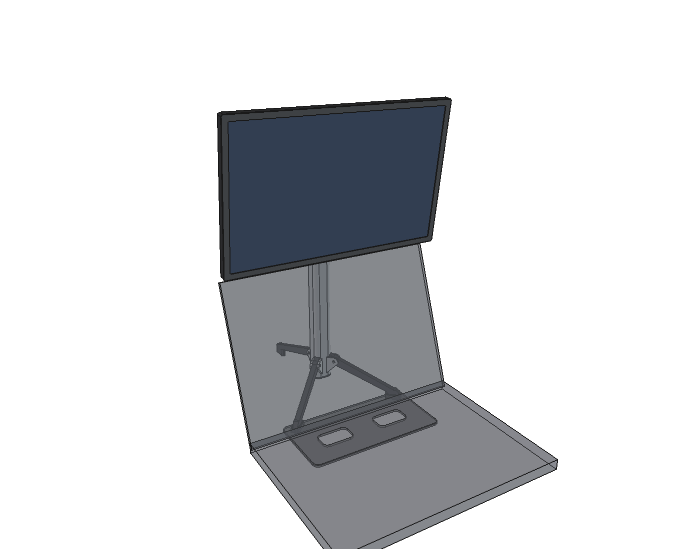
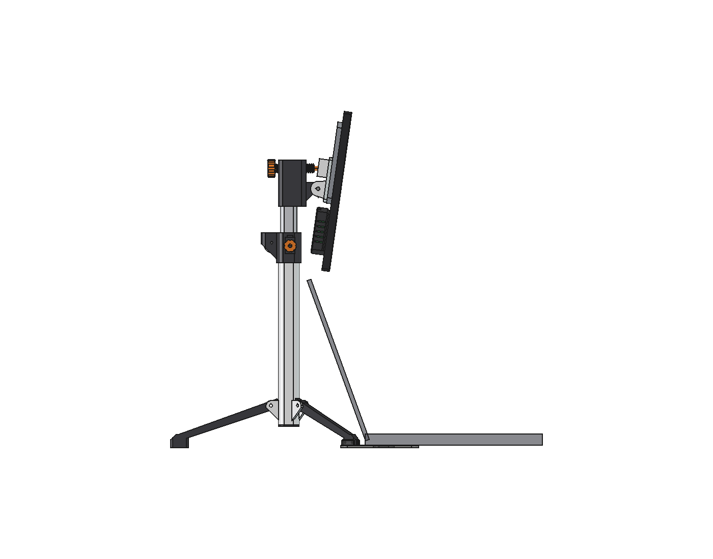

# Portable stand for display case v2 (sits above the Legion's screen)

A folding tripod with a slim printed mast. It puts display case v2 above the lid of a
Legion Slim 7 16" (16IRH8). Everything prints in Numakers ABS on the Centauri Carbon. The only
bought parts are one constant-force spring, some screws and rubber feet.




| | |
|---|---|
| Height | No knob. Push the screen up or down and it stays there: a constant-force spring in the top collar carries the 1.13 kg that moves. 123 mm of travel puts the bezel bottom **222 to 345 mm** above the table. |
| Tilt | Turn the orange knob at the back of the head. **−15° to +15°**, 5.6° per turn, self-locking. Turning it puts no push on the screen, so it can't tip the stand. |
| Lock / friction | Thumb knob on the side of the collar. Snug it to add friction; tighten it to lock the mast for carrying. |
| Display | The VESA plate stays on the case and slides down onto a dovetail on the head. |
| Packed | Legs fold flat against the mast. The bundle is about 355 mm long and 60 mm across; the display and the two flat plates go in the bag separately. |
| Mast | 30 × 30 mm rounded square outside, 23.6 × 24 mm inner tube |

## Where to put it

Set the stand behind the laptop so the **Legion's back edge is 112 mm in front of the mast**.
Snap the two front feet into the **laptop plate** (it clicks between the rails) and slide the
plate's front under the Legion, about 78 mm. The laptop's rear feet then sit on the plate and
its weight anchors the stand.

| Legion lid | Lid top height | Raise the mast at least |
|---|---|---|
| 90° | 262 mm | 50 mm |
| 110° | 247 mm | 35 mm |
| 120° | 229 mm | 16 mm |
| 135° | 189 mm | 0 |

Those are the heights for a 10 mm gap under the bezel. The lid length and hinge height are
estimates, so check them against your laptop.

## Stability (be aware of this)

Figures are the horizontal push at the screen top that tips it, from `checks.txt`:

| | Lowest position | Highest position |
|---|---|---|
| Tripod alone | 1.4 N | 1.1 N |
| With the laptop plate | 2.9 N | 2.2 N |
| With the Legion sitting on the plate | **4.7 N** | **3.7 N** |

Your current desk stand tips at about 2 N. Here the screen is 0.92 kg at up to 58 cm, about 7 cm
in front of the mast, and the whole stand weighs 0.5 kg. That limits what any light tripod can
do. The Legion-on-plate figure assumes 8 N of the laptop's weight rests on the plate.

- **Use the plate under the laptop.** It roughly triples the margin.
- **Tilt with the knob.** Don't push the screen to tilt it.
- **Don't lift the stand by the display.** The dovetail has no latch yet, so the display would slide off.

## Bought parts

| Part | Qty | Notes |
|---|---|---|
| Constant-force spring | 1 | **≈ 11 N (1.1 kgf)**, anything from 9.5 to 12 N is fine. Strip ≤ 12.7 mm wide, coil OD ≤ 22 mm, coil ID ≈ 14 mm, **strip length ≥ 300 mm** (you thread it the length of the tube during assembly), with a hole in the strip end. |
| M5 × 40 socket head + M5 nyloc + 2 washers | 1 | Tilt pivot. Snug it; the lead screw holds the angle. |
| M5 × 20 hex bolt + M5 nut | 1 | Brake. Press the bolt head into the brake knob; the nut drops into the slot on top of the collar boss. |
| M4 × 25 socket head + M4 nyloc | 3 | Leg pivots. |
| M3 × 25 + nut | 1 | Spring drum axle. |
| M3 × 22 | 1 | Strip hook in the inner foot. Its tip must stand **1.0 to 1.3 mm** proud of the foot's rear recess face; file it to length. |
| M3 × 10 self-tapping | 3 | Collar to outer tube, head to inner tube, bottom cap. |
| M4 × 8 socket head | 4 | VESA plate to the case: v2 spine or v3 brass inserts (same as the old stand). |
| 10 mm rubber bumpers | 3 | Under the rear foot, plus the front feet when you use it without the plate. |
| PTFE tape | – | Optional, on the inner tube's side faces: smoother travel, less play. |

## Printing: Numakers ABS on the Centauri Carbon

All parts are exported in print orientation in `3d_print_files/` (STL + STEP). No supports are needed.

- **Nozzle 245 °C, bed 100–105 °C.** Close the enclosure and let the bed heat-soak for about 10 minutes first.
- **Part fan off,** except up to 30 % for bridges and overhangs (Numakers' guidance).
- 0.2 mm layers, **4 walls**, 25 % gyroid. Elephant-foot compensation 0.15.
- Set XY shrinkage compensation for this ABS (about 100.5–100.7 %; calibrate it). The sliding fits
  are 0.2 mm per side, and the tubes need to match.
- Tilt screw and nut: variable layer height of about 0.12 mm on the thread.

| Bed | Parts | Notes |
|---|---|---|
| A | `outer_tube` (250 tall), `inner_tube` (240 tall) | Upright, **8 mm brim**. Slow the top half. |
| B | `laptop_plate` (224 × 114), `vesa_plate` (112 × 120) | Flat. The 16 mm strip on the VESA plate's face is the intended rear-panel seam relief (a short bridge). |
| C | 3 legs (on their side), `top_collar`, `head`, `bracket` (dovetail down), `tilt_screw` (knob down), `tilt_nut`, `inner_foot`, `bottom_cap`, `brake_knob`, `brake_pad`, `spring_drum` | |

The ABS adds up to about 416 g.

## Assembly

1. **Spring:** put the coil on `spring_drum` and drop it into the open top of the collar's rear
   housing. Push the M3 × 25 axle through. Lead the strip end forward through the window and
   down out of the collar's bore.
2. **Collar:** slide it onto the top of the outer tube, with the housing at the back and the brake
   boss on the right, and fix it with an M3 self-tapper. Pull the strip all the way down through
   the outer tube and out of the bottom.
3. **Inner foot:** fit the M3 × 22 hook screw. Press the foot into the bottom of the inner tube,
   recess to the back. Hook the strip's end hole over the screw tip.
4. Feed the inner tube **top first** up into the outer tube from the bottom, with the strip lying in
   its rear recess. The spring winds the strip back up as you go. Fit the bottom cap.
5. **Brake:** drop the M5 nut into the boss, put the pad in its window, and screw the knob in until
   it just touches.
6. **Head:** push it onto the inner tube and fix it with an M3 self-tapper. Drop the tilt nut into its
   slot and screw the tilt screw in from the back.
7. **Bracket:** slide it down over the head's nose so the screw's ball enters the channel from below.
   Fit the M5 pivot bolt.
8. **Legs:** fit the M4 pivots. They swing out until their heels stop on the tube, and fold up flat.
9. **Display:** fix the VESA plate to the case with 4 × M4 × 8, arrow up. Slide the display down onto
   the dovetail.

## Checks (`checks.txt`, all pass)

| Check | Result |
|---|---|
| Display to stand, full height × tilt sweep | ≥ 3.1 mm |
| Bracket to head | 0.30 mm (cheek gap), no overlap |
| Ball in channel | no overlap |
| Legs | heels sit exactly on the tube when deployed; folded legs clear everything by 0.2 mm |
| Spring vs moving mass | 1128 g = 11.1 N against an 11 N spring; the brake covers the rest |
| Lead screws | self-locking (3.7° lead angle vs a 26° friction angle) |
| Bed fit | every part fits 256 × 256 × 256 |
| Overhang > 46° | thread flanks and teardrop tips only, all under 0.3 cm² |

**Not checked:** wobble of the printed mast (it's less stiff than aluminium, and PTFE tape helps),
the brake's holding force, and the snap-fit force on the plate.

**Cables:** at full forward tilt (−15°), a rigid 45 mm plug under the io_block would touch the
mast. Use right-angle cables, or keep tilt at −10° or less at the lowest heights.

## Files

| | |
|---|---|
| `stand_portable.py` | Parametric FreeCAD build, checks, export and renders. All dimensions are at the top. |
| `stand_portable.FCStd` | Assembly above the laptop at −8°. |
| `stand_portable_folded.FCStd` | Packed state. |
| `3d_print_files/` | Every part in print orientation. |
| `renders/` | The pictures above, plus a rear view, stand only, and folded. |

```python
import sys; sys.path.insert(0, "/home/rohith/project_docker/workspace/display_case/stand_portable")
import stand_portable as s
s.build(); s.checks(); s.export(); s.render()
```
