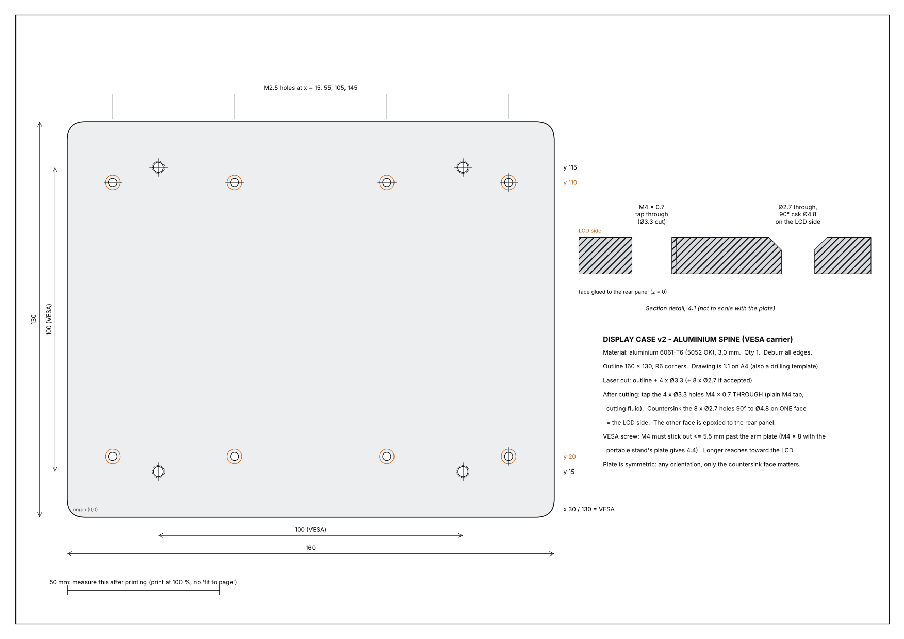
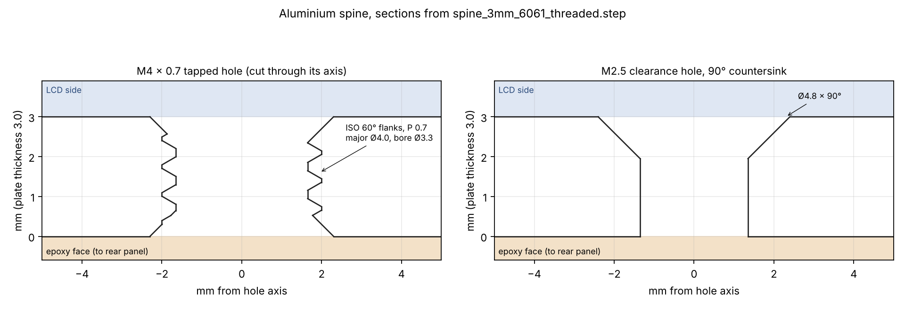

# Aluminium spine: display case v2 VESA carrier

A 160 × 130 × 3 mm aluminium plate epoxied inside the rear panel. The four VESA M4 screws
thread into it. Order it laser-cut, then tap and countersink it yourself.

## Ordering on Robu (metal laser cutting)

1. Upload **`spine_3mm_laser_cut.dxf`**. It's in mm: one closed outline plus 12 circles.
2. Material **aluminium, 3 mm**. Qty 1. Ask for 6061 if they offer a choice; 5052 also works.
3. If Robu rejects or flags the eight Ø2.7 holes (they're smaller than the 3 mm thickness, which many
   lasers won't cut cleanly), upload **`spine_3mm_laser_cut_no_M2.5_holes.dxf`** instead and drill
   those eight yourself using the 1:1 drawing as a template.

Robu only cuts in 2D. It doesn't tap threads or countersink, so those two jobs are yours.

## After it arrives

| Step | Tool |
|---|---|
| Deburr all edges | file or deburring tool |
| Tap the 4 × Ø3.3 holes **M4 × 0.7, all the way through** | M4 tap + tap wrench, cutting fluid, keep it square |
| Countersink the 8 × Ø2.7 holes, 90°, to Ø4.8, **all on the same face** | 90° countersink bit |

The countersunk face is the **LCD side**; the other face gets the epoxy. The plate is symmetric,
so it doesn't matter which corner goes where.

## Screws

- **VESA:** M4 into the tapped holes. The screw must stick out **no more than 5.5 mm** past the
  mounting plate it clamps. With the portable stand's 7 mm VESA plate, M4 × 8 sticks out 4.4 mm
  and the tip stays 1.1 mm inside this plate. Longer screws head toward the LCD.
- **Clamping it into the case:** 8 × M2.5 × 8 countersunk thread-forming screws for plastic,
  from the LCD side into the rear panel's Ø2.1 pilot holes. They only hold the plate while the
  epoxy cures; the epoxy carries the load.

## Change from the original v2 plan

v2's assembly notes said to drill the M4 holes **2.5 mm deep, blind**, and use a bottoming tap.
They're now **through holes**: a laser can't make a blind hole, and a 2.5 mm blind thread in
3 mm plate is hard to tap by hand. The 5.5 mm screw limit above replaces the old 5.0 mm one.

## Files

| | |
|---|---|
| `spine_3mm_laser_cut.dxf` | Order file: outline, 4 × Ø3.3, 8 × Ø2.7 |
| `spine_3mm_laser_cut_no_M2.5_holes.dxf` | Fallback order file: outline and 4 × Ø3.3 only |
| `spine_3mm_drawing_1to1_A4.pdf` | Dimensioned drawing. Print at 100 % and it doubles as a drilling template (check the 50 mm bar). |
| `spine_3mm_6061_threaded.step` | 3D model with real M4 × 0.7 ISO threads and the countersinks |
| `spine_3mm_6061_plain_holes.step` | Same part with the tap-drill holes only, the usual form for quoting or CNC |
| `spine_3mm_6061.FCStd` | FreeCAD document of the threaded model |
| `make_spine_files.py`, `make_spine_step.py` | Regenerate the DXFs and drawing, and the STEP files |

Mass: about 167 g in 6061.
