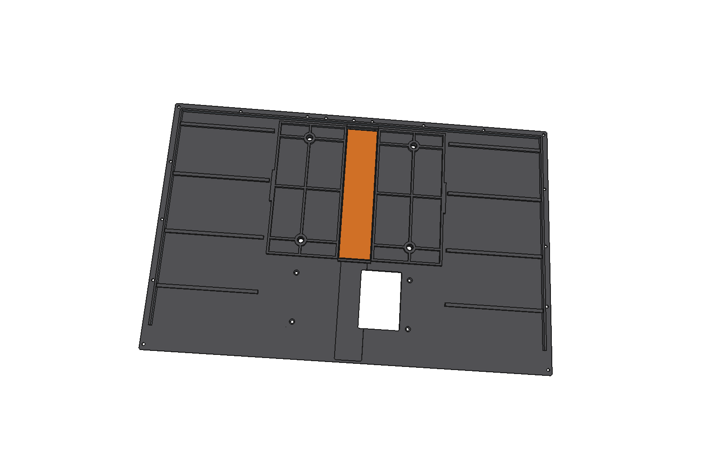
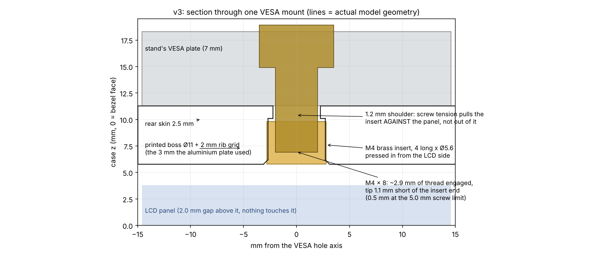

# Display case v3: all printed, brass-insert VESA

v3 is v2 with **no aluminium**. The 160 × 130 × 3 mm aluminium spine is gone. In its place
the rear panel has printed bosses for **M4 brass heat-set inserts** and a stiffening rib grid,
and a small printed **seam bridge** takes over the spine's job of bridging the rear seam.
The front frame, I/O block, rear splice, LCD, board, fit and the outside look are all unchanged
from v2.

## What changed

| | v2 | v3 |
|---|---|---|
| VESA thread | M4 tapped into a glued-in aluminium plate | **M4 brass insert** in a printed boss, pressed in from the LCD side |
| Stiffness behind the VESA pattern | 3 mm aluminium plate | 2 mm printed rib grid joining the 4 bosses, in the same 3 mm space |
| Rear seam inside the VESA zone | the aluminium plate | printed `seam_bridge`, 30 × 127.5 × 3, bonded across the seam |
| Spine pilot holes (8 × Ø2.1) | used by the M2.5 clamp screws | filled |
| Clearance to the LCD | 2.0 mm | 2.0 mm (checked) |
| Outside of the rear panel | 4 × Ø4.5 holes | identical |

## The inserts

- Default insert: **M4 × 4 mm long × Ø5.6 mm OD**, knurled brass. That's the longest that fits:
  there's only 5.5 mm of plastic between the outer face and the 2 mm air gap above the LCD.
- Each pocket is **Ø5.4 × 4.3 mm deep**, opening on the **LCD side** of the boss. Above it is a
  1.2 mm shoulder, then the Ø4.5 hole to the outside.
- **Why from the inside:** when you tighten the VESA screw, it pulls the insert *against* that
  shoulder. It can't pull out the way an insert pressed in from the back can.
- **If your inserts are a different size,** change `INSERT_OD` / `INSERT_L` at the top of
  `build_v3.py` and run `build()` again. All the print files and checks regenerate.

**Fitting them:** before assembly, lay the rear-panel half outer face down on a flat surface and
press each insert in from the inside with a soldering iron. Use about 230–250 °C for ABS.
Keep it square and stop flush with the boss face. Let it cool before moving the part.

## VESA screws

- **M4, at most 5.0 mm past the arm or stand plate.** The insert's open end faces the LCD gap,
  so a longer screw heads toward the panel.
- **M4 × 8 with either of your stands' VESA plates** sticks out 4.4 mm and engages about 2.9 mm
  of thread.
- Tighten them snug, about 0.5–0.8 N·m. That's plenty for a 0.92 kg display; more torque only
  loads the plastic shoulder.

## Assembly (v2's order; changes in bold)

1. Bond the two front-frame halves at the laps. Cure flat.
2. Bond `rear_splice` into its recess across the rear-panel seam. Cure flat.
3. **Press in the 4 M4 inserts from the inside (see above).**
4. **Bond `seam_bridge` onto the inner face, across the seam, between the two small locating
   fences at the top and bottom of the VESA zone.** Epoxy works for any material; for ABS prints,
   ABS-in-acetone slurry also works. Its flat printed face goes down onto the panel. Cure flat.
5. Driver board onto the 4 standoffs in `io_block` (M2.5 × 5 pan).
6. 1.5 mm foam tape on the three clamp ribs only (top and both sides). Nothing on the rib grid
   or the seam bridge: they're held 2.0 mm off the LCD on purpose.
7. Front frame face down, drop the panel in, and push it onto the +X/+Y datum pads.
8. Route eDP and backlight through the bay opening.
9. `io_block` onto the rear panel, 4 × M2.5 × 8 countersunk from inside.
10. Rear panel bottom edge under the frame tongue, pivot down, 17 perimeter screws.

**Screws:** 21 × M2.5 × 8 countersunk (17 perimeter, 4 I/O block; v2's 8 spine screws are gone)
and 4 × M2.5 × 5 pan for the board. All of them are **thread-forming screws for plastic** into
the Ø2.1 pilots, not machine screws.

## Print beds (256 × 256)

| Bed | Part | Notes |
|---|---|---|
| `bed1_front_frame_L`, `bed2_front_frame_R` | front frame halves | unchanged from v2 |
| `bed3_rear_panel_L`, `bed4_rear_panel_R` | **v3 rear panel halves** | same position and orientation as v2: visible back down, bosses and ribs up |
| `bed5_io_block_splice` | io_block + rear_splice | unchanged from v2 |
| `bed6_seam_bridge` | **seam_bridge** | 29.7 × 127.3 × 3, flat bonding face down. It's tiny, so add it to any other bed. |

`3d_print_files/` also has the `_selfsupport` variants of both rear-panel halves (v2's lip fix)
with the same v3 changes. The new bosses, ribs and pockets add **no overhangs**: the bridging
area of each half is identical to v2.

The rear panel halves are 181 × 233 mm flat plates. In Numakers ABS, use a brim, the enclosure
closed, the bed at 100–105 °C, and the part fan off.

## Checks (`checks.txt`)

| Check | Result |
|---|---|
| New bosses / ribs / seam bridge to the LCD | 2.00 mm (same as v2) |
| Overlap with LCD, board, io_block, front frame | 0.000 mm³ |
| Seam bridge on the panel | touching, no overlap |
| Old spine pilots | filled flush |
| Added material | 8.6 cm³ (≈ 9 g) |

## Files

| | |
|---|---|
| `monitor_case_v3.FCStd` | assembly: front_frame, rear_panel (v3), seam_bridge, io_block, panel_ref, board_ref |
| `build_v3.py` | builds all of v3 from v2's files; parameters at the top |
| `3d_print_files/` | every part in print orientation, STEP + STL |
| `print_beds/` | beds 1–6 |
| `renders/` | inside views and the VESA section |
| `checks.txt` | output of the last build |
